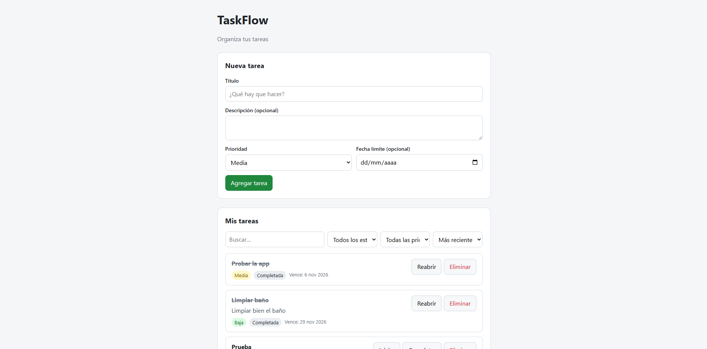

# TaskFlow

[](https://github.com/aletz2001/taskflow/actions/workflows/ci.yml)

Gestor de tareas full stack: una **API REST en .NET 11** con arquitectura en capas y un **frontend en React + TypeScript**.
Proyecto de práctica enfocado en aplicar principios **SOLID**, **patrones de diseño** y **buenas prácticas** de desarrollo profesional.



## Funcionalidades

- Crear tareas con título, descripción, prioridad y fecha límite.
- Listar con filtros (estado, prioridad, búsqueda de texto) y 3 ordenamientos.
- Flujo de estados con reglas de negocio: Pendiente → En progreso → Completada, y reabrir.
- Detección de tareas vencidas.
- Errores claros y consistentes con el formato estándar **ProblemDetails** (RFC 9457).

## Tecnologías

| Backend | Frontend | Calidad |
|---|---|---|
| .NET 11 · ASP.NET Core Minimal APIs | React 19 · TypeScript (modo estricto) | xUnit: pruebas unitarias y de integración |
| Entity Framework Core 11 · SQLite | Vite | ESLint |
| OpenAPI + Scalar | Fetch API | GitHub Actions (CI) |

## Arquitectura

```
backend/TaskFlow.Api/
├── Domain/           Entidad TaskItem y reglas de negocio (sin dependencias externas)
├── Application/      Casos de uso (TaskService), DTOs, interfaces y estrategias de orden
├── Infrastructure/   EF Core: DbContext, repositorio, configuración y migraciones
└── Endpoints/        Minimal APIs y manejo global de errores

frontend/src/
├── api/              Cliente HTTP tipado
├── components/       Componentes de UI
├── hooks/            Lógica reutilizable (useTasks, useDebouncedValue)
└── types/            Contratos que reflejan los DTOs del backend
```

Las dependencias apuntan hacia el dominio: **Application** define las interfaces (`ITaskRepository`, `IUnitOfWork`) e **Infrastructure** las implementa.

### Principios y patrones aplicados

| | Dónde |
|---|---|
| **SRP** | Dominio, servicio, repositorio, endpoints y manejo de errores separados |
| **OCP** + **Strategy** | Ordenamientos intercambiables: agregar uno nuevo no modifica código existente |
| **DIP** | El servicio depende de abstracciones; las pruebas usan implementaciones en memoria |
| **ISP** | `ITaskRepository` separado de `IUnitOfWork` |
| **Repository** + **Unit of Work** | Acceso a datos con EF Core |
| **Factory Method** | `TaskItem.Create()`: toda tarea nace válida |
| **Encapsulamiento** | El estado solo cambia mediante métodos que validan las reglas |

## Cómo ejecutarlo

**Requisitos:** [.NET SDK 11](https://dotnet.microsoft.com/download) y [Node.js 24+](https://nodejs.org/).

```bash
git clone https://github.com/aletz2001/taskflow.git
cd taskflow
dotnet tool restore
```

**1. API** (la base de datos SQLite se crea y migra sola en desarrollo):

```bash
cd backend/TaskFlow.Api
dotnet run --launch-profile https
```

Documentación interactiva de la API: `https://localhost:<puerto>/scalar`

**2. Frontend** (en otra terminal):

```bash
cd frontend
npm install
npm run dev
```

Abrir `http://localhost:5173`. En desarrollo, Vite reenvía `/api` a la API mediante un proxy (ver `vite.config.ts`).

**3. Pruebas:**

```bash
dotnet test        # desde la raíz del repositorio
```

## Endpoints

| Método | Ruta | Descripción |
|---|---|---|
| `GET` | `/api/tasks?status=&priority=&search=&sort=` | Lista con filtros y orden |
| `GET` | `/api/tasks/{id}` | Obtiene una tarea |
| `POST` | `/api/tasks` | Crea una tarea |
| `PUT` | `/api/tasks/{id}` | Edita una tarea |
| `POST` | `/api/tasks/{id}/start` · `/complete` · `/reopen` | Cambia el estado |
| `DELETE` | `/api/tasks/{id}` | Elimina una tarea |

## Decisiones de diseño

- **Un proyecto con carpetas por capa** en lugar de varios proyectos: es suficiente para este tamaño y se puede separar si crece.
- **Sin repositorio genérico ni AutoMapper**: `DbSet<T>` ya cubre lo genérico, y el mapeo manual es explícito y verificado por el compilador.
- **`TimeProvider`** en lugar de `DateTime.Now`, para poder probar la lógica que depende de fechas.
- **SQLite** para que el proyecto se ejecute sin instalar un motor de base de datos.

